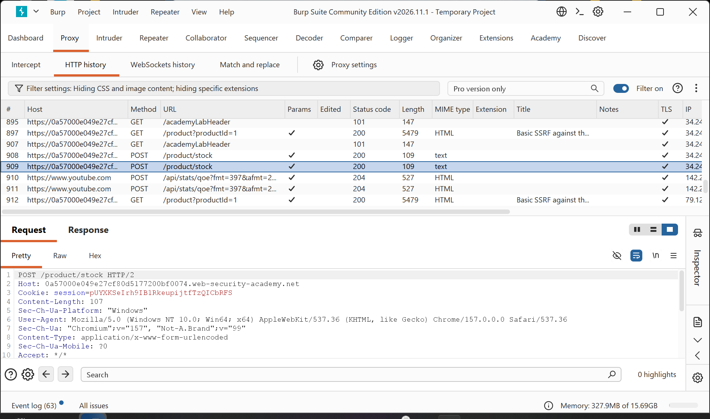
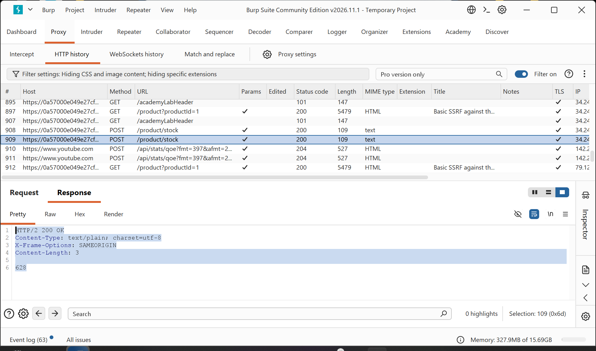
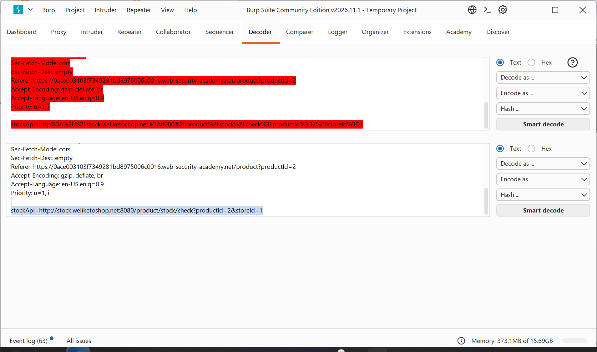
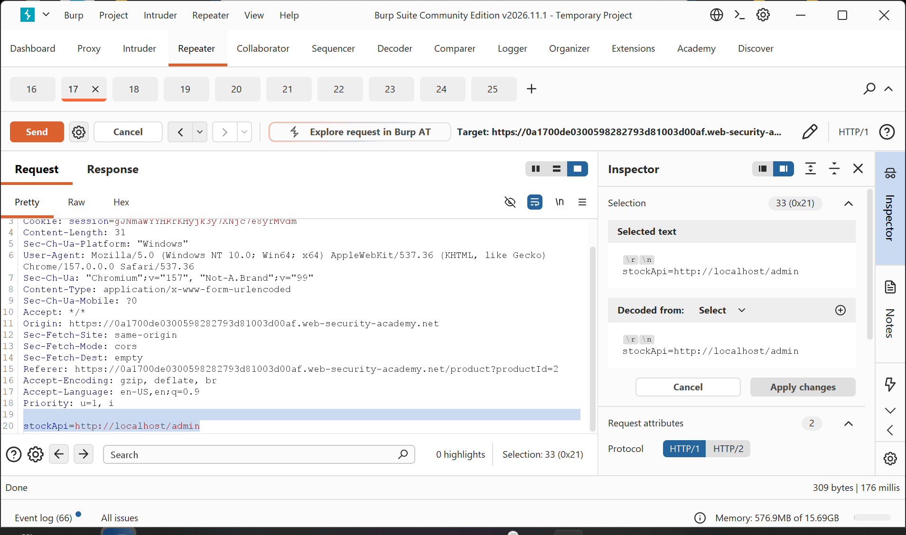
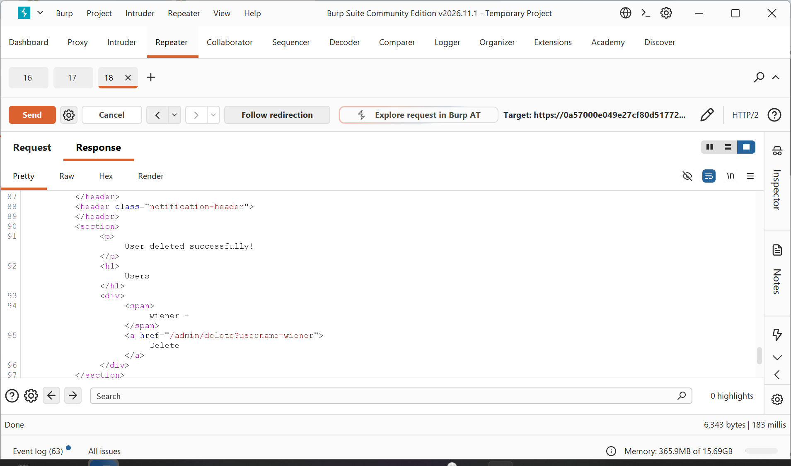
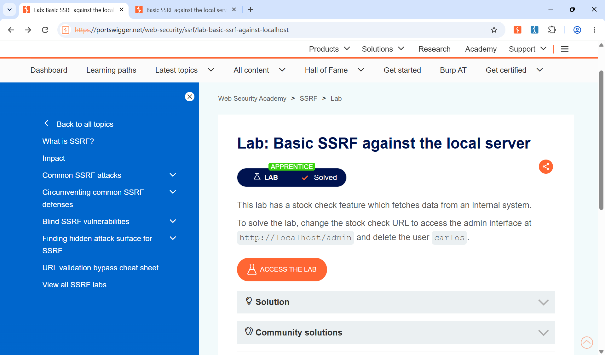

# Lab 01: Basic SSRF Against the Local Server

**Platform:** PortSwigger Web Security Academy  
**Tool:** Burp Suite Community Edition  
**Vulnerability:** Server-Side Request Forgery (SSRF)  
**Vulnerable Feature:** Stock-check functionality  
**Lab Status:** Completed

**Goal:** Modify the stock-check URL to access the internal administrative interface at `http://localhost/admin` and delete the user `carlos`.

---

## 1. Understand

### What is SSRF?

Server-Side Request Forgery (SSRF) occurs when an attacker manipulates an application into making requests to unintended destinations.

An application may accept a user-controlled URL and use it to retrieve information. If the server does not properly restrict the destination, an attacker may be able to access internal resources.

### Security Boundary

The application server may have access to internal services that external users cannot access directly.

The vulnerability occurs when an external user can influence the application server to make requests across that security boundary.

---

## 2. Observe

### Original HTTP Request

Using Burp Suite, I captured the request generated by the stock-check functionality.

| Component | Observation |
|---|---|
| HTTP Method | POST |
| Endpoint | `/product/stock` |
| Protocol | HTTP/2 |
| Parameter | `stockApi` |
| Content-Type | `application/x-www-form-urlencoded` |
| Normal Response | `200 OK` |
| Response Body | Stock quantity (e.g. `825`; `628` in the screenshot session) |

The `stockApi` parameter contained a URL pointing to the inventory service. URL-decoded with Burp Decoder, the original value was:

```text
stockApi=http://stock.weliketoshop.net:8080/product/stock/check?productId=2&storeId=1
```

**Observation:** The stock-check functionality accepted a complete URL through the `stockApi` parameter.

This identified a potential user-controlled destination worth investigating.

---

## 3. Hypothesize

### Hypothesis H1

I hypothesized that the application server might accept a modified `stockApi` URL without sufficiently validating the destination.

If correct, an attacker could potentially manipulate the server into communicating with internal resources.

**Expected Result:** Changing the destination to an internal administrative URL may cause the server to retrieve information that cannot be accessed directly through the public website.

**Hypothesis Status:** Not tested at the time of formulation.

---

## 4. Test and Record Evidence

### Test 0: Direct Administrative Access

**Objective:** Determine whether the administrative interface could be accessed directly through the browser.

**Test URL:** `/admin`

**Observation:** Direct browser access to the administrative interface was restricted.

**Result:** The administrative interface could not be accessed directly.

**HTTP Status Code:** Not recorded.

**Conclusion:** Direct access was restricted, whereas the subsequent SSRF test successfully retrieved the same interface through the application server.

### Test 1: Access Internal Admin Interface Using SSRF

**Objective:** Determine whether the application server can retrieve the internal administrative interface.

**Modified Parameter:**

```text
stockApi=http://localhost/admin
```

**Result:**

The server returned:

```http
HTTP/2 200 OK
Content-Type: text/html; charset=utf-8
```

The response contained HTML displaying the administrative interface and its users.

The HTML included:

```html
<a href="/admin/delete?username=carlos">Delete</a>
```

**Evidence:** The server successfully retrieved the internal administrative interface through the user-controlled `stockApi` parameter.

### Why Was `/admin` Reachable?

Direct access to `/admin` was restricted, but the application server could retrieve the administrative interface through `localhost`.

The SSRF vulnerability allowed an external user to exploit this difference in access.

The precise internal authorization logic was not examined.

### Test 2: Trigger Unauthorized User Deletion

**Objective:** Determine whether SSRF could trigger an administrative action.

**Modified Parameter:**

```text
stockApi=http://localhost/admin/delete?username=carlos
```

**Result:**

The HTML response contained:

```html
<p>User deleted successfully!</p>
```

The PortSwigger lab subsequently displayed a completed status.

**Evidence:** The response reported that the administrative deletion operation succeeded, and the lab confirmed successful completion.

**Hypothesis Status:** Supported.

---

## 5. Conclude and Reflect

### Technical Conclusion

The application allowed a user-controlled URL to trigger an administrative action through SSRF.

The stock-check functionality could be manipulated to retrieve the internal administrative interface and submit a request to delete a user.

### Root Cause

The application did not sufficiently restrict the destination URLs supplied through the `stockApi` parameter.

The server was therefore able to make an unintended request to an internal administrative endpoint.

### Potential Risk

An attacker could exploit SSRF to access internal services that are not directly exposed to external users.

In this lab, SSRF enabled the unauthorized deletion of a user account.

Depending on network access and application permissions, similar vulnerabilities could expose sensitive information or allow interactions with additional internal systems.

### Remediation

1. **Avoid user-controlled destination URLs:** Accept product and store identifiers instead of arbitrary URLs, and construct the inventory-service request on the application server.

2. **Implement destination allowlisting:** If URLs are necessary, restrict requests to explicitly approved destinations and validate resolved addresses and redirects.

3. **Restrict internal network access:** Prevent the application server from making unnecessary requests to loopback addresses and internal services.

4. **Enforce administrative authorization:** Require proper authentication and authorization for sensitive administrative operations instead of relying solely on the request's network origin.

### Lessons Learned

- I learned how to capture and analyze HTTP requests using Burp Suite.
- I learned how Repeater allows a request to be modified and resent.
- I learned that URL parameters can influence where an application server sends requests.
- I learned that `localhost` refers to the machine processing the URL, not necessarily my own computer.
- I learned that SSRF can potentially trigger unauthorized administrative actions, not just retrieve information.
- I learned how to use HTTP responses and HTML source code as evidence during an investigation.

---

## Evidence Screenshots

Screenshots were taken across more than one lab instance, so hostnames differ between images.

**Original stock-check request (Proxy history)**



**Baseline response: stock quantity**



**Original `stockApi` value, URL-decoded in Burp Decoder**



**SSRF payload `stockApi=http://localhost/admin` in Repeater** (admin panel response not captured)



**Deletion response: `User deleted successfully!`, only `wiener` remains**



**PortSwigger completion confirmation**



**Not captured:** direct browser access to `/admin` (Test 0) and the full admin panel response (Test 1).

**Security Note:** Session cookies visible in the screenshots belong to temporary PortSwigger lab instances that have since expired.

---

## Final Investigation Status

**Vulnerability:** Confirmed SSRF  
**Severity:** High (unauthenticated user can perform administrative actions)  
**Hypothesis:** Supported  
**Administrative Access:** Demonstrated  
**Unauthorized Action:** Demonstrated  
**Lab Status:** Completed